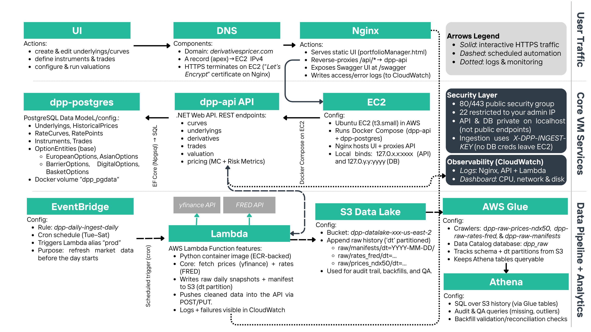

# Derivatives Portfolio Pricer

An open-source, full-stack derivatives portfolio valuation platform deployed on AWS. It combines a browser-based UI, an ASP.NET pricing API, a PostgreSQL database, and an automated market-data pipeline to value portfolios of classical and exotic options using Monte Carlo simulation.

**Live demo:** [derivativespricer.com](https://derivativespricer.com/)

<p align="center">
  
</p>

---

## What the platform does

The workflow mirrors how buy-side practitioners handle valuation:

1. **Define market inputs** -- underlyings with historical prices and interest rate curves.
2. **Define instruments** -- option contracts linked to underlyings, with strike, expiration, and contract-specific parameters.
3. **Create trades** -- positions that reference an instrument with a quantity and trade date.
4. **Run valuation** -- the Monte Carlo engine prices every selected trade and aggregates results at the portfolio level.

The core outputs for each trade are:

- **Price and Standard Error** -- the theoretical value and its estimation uncertainty.
- **Greeks** -- Delta, Gamma, Vega, Theta, and Rho, computed via finite-difference bumping.

---

## Supported instruments

| Type | Payoff style |
|------|-------------|
| European | Vanilla call / put on terminal price |
| Asian | Geometric-average call / put |
| Digital | Binary (cash-or-nothing) with rebate |
| Barrier | Up-and-In, Up-and-Out, Down-and-In, Down-and-Out |
| Lookback | Floating strike based on path max / min |
| Range | Max minus Min over the path |

---

## Monte Carlo engine

The pricing engine (`MCAntVDControlVariate.cs`) implements several variance-reduction and sampling techniques that are standard in production Monte Carlo settings:

| Technique | Purpose |
|-----------|---------|
| Euler-Maruyama discretization | Evolve the underlying price path through time |
| Antithetic variates | Pair each +Z path with its -Z mirror to cut variance |
| Control variates (Delta hedging) | Further reduce estimator variance using a known hedge |
| Van der Corput low-discrepancy sequence | Quasi-random alternative to pseudo-random sampling |
| Box-Muller transform | Generate standard-normal draws from uniforms |
| Parallel execution | Multi-threaded path generation via `Parallel.For` |

Users can configure the number of paths, time steps, and which variance-reduction methods to enable from the UI.

---

## Architecture layers

The system is organized into six layers, each with a clear responsibility:

| Layer | Technology | Role |
|-------|-----------|------|
| **Front door** | Nginx | Serves the static UI and reverse-proxies `/api/*` to the internal API container |
| **Application** | ASP.NET 8 (C#) | REST endpoints for underlyings, derivatives, trades, rate curves, simulation, and valuation |
| **Database** | PostgreSQL 16 | Relational store for instruments, trades, historical prices, and rate curves |
| **Pricing** | C# Monte Carlo engine | Computes prices and Greeks for all supported contract types |
| **Data engineering** | AWS Lambda + S3 + Glue + Athena | Scheduled ingestion of equity prices (yfinance) and yield curves (FRED) using Python, with append-only S3 snapshots and Athena SQL for audits |
| **Observability** | CloudWatch | Centralized logs from Nginx, the API container, and Lambda; dashboards for CPU, network, and disk |

All components run on a single EC2 instance (t3.small). The API and database are bound to `localhost`, keeping only port 80/443 public. Ingestion authenticates via a header-based API key (`X-DPP-INGEST-KEY`), avoiding any exposure of database credentials outside the host.

---

## Repository layout

```
dpp-app/
  MCSimulator/
    MCAntVDControlVariate.cs          # Monte Carlo engine (shared by API and solution)
    MCSimulator.csproj / .sln         # .NET solution
    MonteCarloSimulatorAPI/
      Controllers/                    # REST endpoints
      Models/                         # EF Core domain models
      Dtos/                           # Data-transfer objects
      Migrations/                     # Database schema migrations
      Data/                           # DbContext
      Program.cs                      # API entry point and middleware
      Dockerfile                      # Multi-stage .NET 8 Docker build
      appsettings.json                # Connection string template
    MonteCarloSimulatorWebApp/
      portfolioManager.html / .js / .css   # Previous UI, kept at /portfolioManager.html; the Overview text lives here
      index.html                           # Landing page
      *.svg / *.png                        # Diagrams and screenshots
  web/                                # Workstation UI (React, TypeScript, Vite)
    src/                              # Screens, charts, API client
    scripts/prebuild.mjs              # Copies the Overview text and images from the previous UI
    package.json / vite.config.ts     # Build setup
  infra/
    nginx/dpp.conf                    # Nginx reverse-proxy config
    lambda/
      lambda_function.py              # Daily ingestion job (prices + rates)
      Dockerfile                      # ECR-backed Lambda container image
      requirements.txt                # Python dependencies
    cloudwatch/
      amazon-cloudwatch-agent.json    # Log collection config
  docker-compose.yml                  # Local orchestration (Postgres + API)
  .env.example                        # Environment variable template
```

---

## Running locally

### Prerequisites

- [.NET 8 SDK](https://dotnet.microsoft.com/download/dotnet/8.0)
- [Docker & Docker Compose](https://docs.docker.com/get-docker/)

### Steps

```bash
# 1. Clone the repo
git clone https://github.com/frankstack/Derivatives-Portfolio-Pricer.git
cd Derivatives-Portfolio-Pricer/dpp-app

# 2. Create your .env from the template
cp .env.example .env
# Edit .env and set DPP_INGEST_KEY to a long random string

# 3. Start Postgres and the API
docker compose up -d

# 4. Apply EF Core migrations (first run only)
cd MCSimulator/MonteCarloSimulatorAPI
dotnet ef database update
cd ../..

# 5. Open the UI
#    Browse to http://localhost:5022/swagger for the API docs.
#    For the UI: cd web && npm install && npm run dev
#    (the dev server proxies /api to the live site; change the target in
#    web/vite.config.ts to http://localhost:5022 to use your local API).
```

> The `docker-compose.yml` binds Postgres to `127.0.0.1:5432` and the API to `127.0.0.1:5022`. Neither is exposed to the network.

---

## Web UI

The UI in `web/` is a static React app: a fixed navigation rail on the left, the data in the center, and the ticket or settings for the section on the right. It calls the API at the same origin under `/api`, uses hash routes (`#/underlyings`, `#/trades`, ...) and relative asset paths, so one build works at the site root and under a sub-path such as `/next/` for previews. Charts are drawn as plain SVG; there is no UI or chart library.

```bash
cd web
npm install
npm run typecheck   # tsc, prints nothing when clean
npm run build       # writes web/dist
```

`npm run build` first runs `scripts/prebuild.mjs`, which copies the Overview text and its images out of `MCSimulator/MonteCarloSimulatorWebApp`, so that folder has to sit next to `web/`.

Deploy: copy `web/dist/` into the Nginx root (`/var/www/dpp-ui`). File names under `assets/` carry a content hash and can be cached for good; `index.html` should always be revalidated. The previous UI stays reachable at `/portfolioManager.html`.

---

## API reference

The API is documented via Swagger at `/swagger` when the service is running. Key endpoint groups:

| Group | Base path | Description |
|-------|-----------|-------------|
| Underlyings | `/api/Underlyings` | CRUD for underlying assets and historical prices |
| OptionEntities | `/api/OptionEntities` | CRUD for option contracts (all six types) |
| Trades | `/api/Trades` | CRUD for portfolio positions |
| RateCurves | `/api/RateCurves` | CRUD for yield curves and rate points |
| Simulation | `/api/simulation/price-option` | Price a single option with custom parameters |
| Valuation | `/api/valuation` | Value selected trades against a rate curve at the portfolio level |

Notes:

- **Valuation date.** `POST /api/valuation` values the book as of now: time to expiry is counted from the moment of the call and the spot is the latest close. Pass an optional `valuationDate` (ISO 8601) to value a past date instead; only closes on or before it are used, and trades done after it come back with status `not_traded_yet`. Every trade in the response carries `status` (`valued`, `expired`, `not_traded_yet`), `quantity`, `unitPrice`, `spot`, `spotDate` and `timeToMaturity`. `price` is the position value (unit price times quantity); the Greeks are per unit.
- **Derivatives.** `GET /api/OptionEntities` returns `optionType` and `optionTypeName`, the type-specific fields `rebate`, `barrier`, `barrierType` and `barrierTypeName`, and the underlying's id, symbol and name. Price history is served by `/api/Underlyings`.
- **Barrier types** are 1 Up-and-In, 2 Up-and-Out, 3 Down-and-In, 4 Down-and-Out on every endpoint, including `/api/simulation/price-option`.

---

## Data pipeline

A containerized AWS Lambda function runs on a cron schedule (Tue-Sat 03:30 UTC, after the US close) via EventBridge:

1. **Fetch** -- pulls NDX-50 daily closes from yfinance and Treasury + SOFR rates from FRED.
2. **Upsert** -- sends every trading day in the window to the API via authenticated POST/PUT. The upsert is idempotent per (symbol, date), so a missed run is repaired by the next one.
3. **Archive** -- writes raw CSV snapshots to S3, one `dt=YYYY-MM-DD` partition per trading day, plus a JSON manifest per run. A day is archived only after Postgres has accepted it.

Glue crawlers catalog the S3 partitions so Athena can query the full history for audits, backfills, and quality checks.

### Self-healing window

A scheduled run re-sends the last `DPP_LOOKBACK_DAYS` (default 10) days. If the newest price partition in S3 is older than that, the window widens back to it automatically (capped by `DPP_MAX_AUTO_BACKFILL_DAYS`, default 120), so an outage of any length up to the cap closes itself on the first successful run. Sessions still in progress are skipped until 16:30 New York time, so an intraday quote is never stored as a close.

Prices are stored as the exchange close (`DPP_PRICE_FIELD=close`). Yahoo does not rewrite that field after dividends, which is what makes the daily re-send idempotent.

### Splits

A stored close is on the share basis of the day it was captured, so a split would leave every older row on the old basis and blow up the historical volatility. When Yahoo reports a split (or an ADR ratio change) inside the window, the job re-pulls that symbol's full history from `DPP_HISTORY_START` (default 2021-01-01) and upserts it in the same run. If that refresh fails, the rest of the run still completes and the invocation is then reported as failed, so the error alarm fires and Lambda retries. Set `DPP_AUTO_SPLIT_REFRESH=false` to switch this off.

### Rate curves

The job takes the latest FRED date on which every required tenor is published and replaces the points of each curve named in `DPP_RATE_CURVE_NAMES` (comma-separated, so a curve name cannot contain a comma; a name that does not exist yet is created). Production updates `USD Treasury + SOFR (FRED Daily)`, the curve the UI lists as predefined, plus `Base1` and `Base2`.

### Manual runs

The function accepts optional event fields:

| Event | Effect |
|-------|--------|
| `{"dry_run": true}` | Fetch and validate only. No API calls, no S3 writes. |
| `{"lookback_days": 45}` | Backfill the last 45 days. |
| `{"start_date": "2026-07-03", "end_date": "2026-10-08"}` | Backfill an explicit range (inclusive). |
| `{"skip_rates": true}` / `{"skip_prices": true}` | Run one half of the job. |
| `{"symbols": ["BKNG"], "start_date": "2021-01-01"}` | Correction run for a subset of the universe: prices only, nothing archived to S3. |

```bash
aws lambda invoke --function-name dpp-daily-ingest:prod \
    --cli-binary-format raw-in-base64-out \
    --payload '{"lookback_days": 45}' out.json && cat out.json
```

### Deploying the function

EventBridge invokes the `prod` alias, never `$LATEST`. A deploy is: update `$LATEST`, dry-run it, publish a version, then move the alias.

```bash
aws lambda update-function-code --function-name dpp-daily-ingest --image-uri <ecr-image>
aws lambda wait function-updated --function-name dpp-daily-ingest
aws lambda invoke --function-name dpp-daily-ingest --cli-binary-format raw-in-base64-out \
    --payload '{"dry_run": true}' out.json && cat out.json
V=$(aws lambda publish-version --function-name dpp-daily-ingest --query Version --output text)
aws lambda update-alias --function-name dpp-daily-ingest --name prod --function-version "$V"
```

After any deploy or outage, confirm the alias target is healthy, not just `$LATEST`:

```bash
aws lambda get-function-configuration --function-name dpp-daily-ingest:prod \
    --query '[Version,State,StateReasonCode]'
```

A published version that sits idle long enough goes `Inactive`, and if it cannot be restored it stays that way while `$LATEST` keeps working. The `dpp-lambda-invocations-lt-1-80h-dpp-daily-ingest-prod` alarm is the signal for that case.

Offline tests (no network, no AWS): `pytest infra/lambda/tests -q`

---

## Tech stack

| Component | Technology |
|-----------|-----------|
| UI | React 19, TypeScript, Vite; charts as plain SVG |
| API | ASP.NET 8, Entity Framework Core, C# |
| Database | PostgreSQL 16 (Alpine) |
| Pricing engine | C# with `System.Threading.Tasks.Parallel` |
| Data pipeline | Python 3.12, yfinance, pandas, boto3 |
| Infrastructure | Docker Compose, Nginx, AWS EC2, Lambda (ECR), S3, Glue, Athena, EventBridge, CloudWatch |

---

## Author

**Frank Ygnacio Rosas**
[LinkedIn](https://www.linkedin.com/in/fsyrosas/) | [linktr.ee/fsyrosas](https://linktr.ee/fsyrosas)


